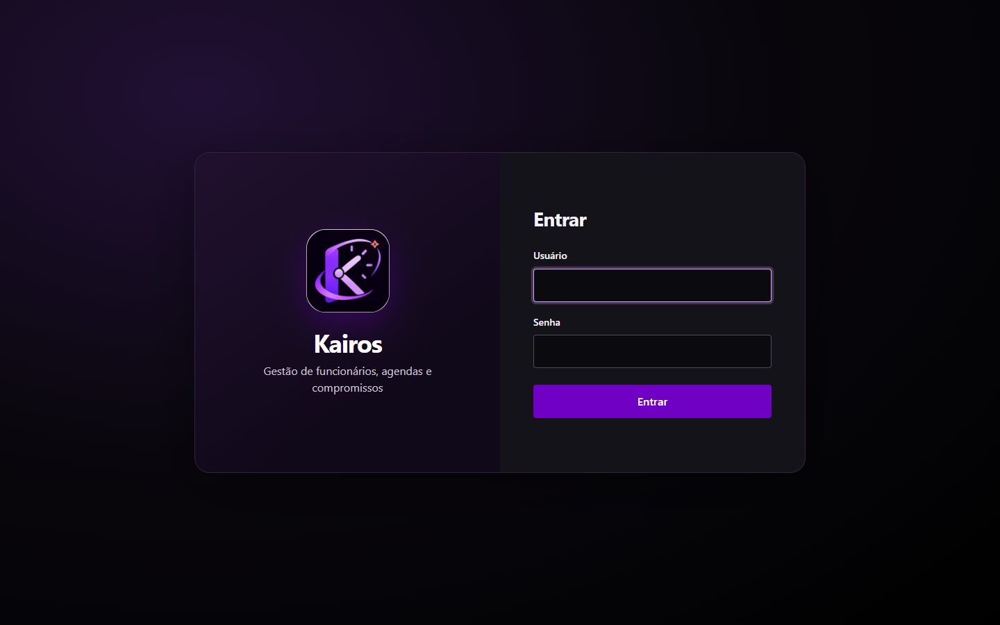
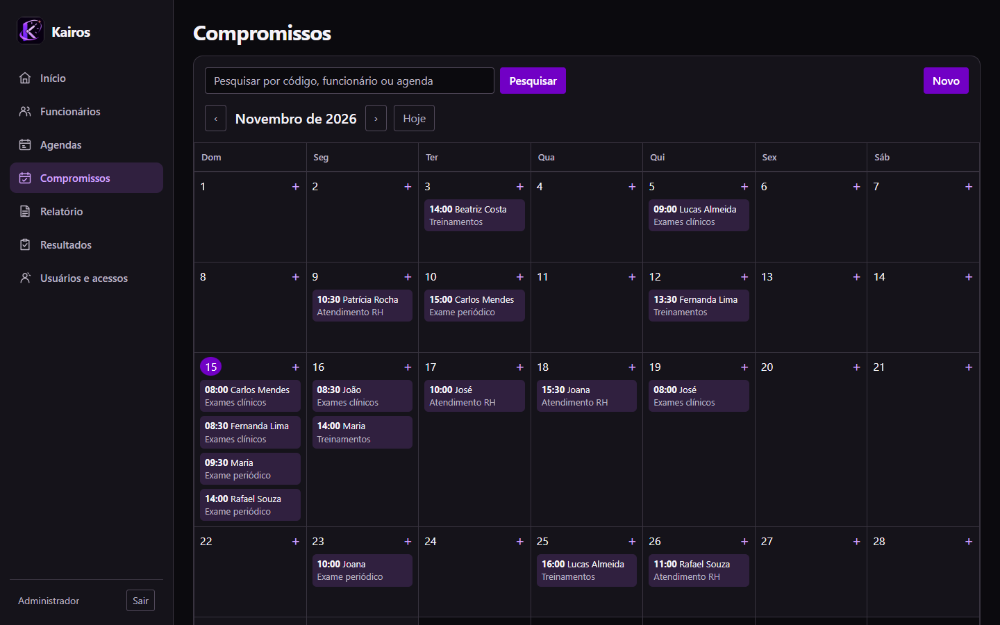
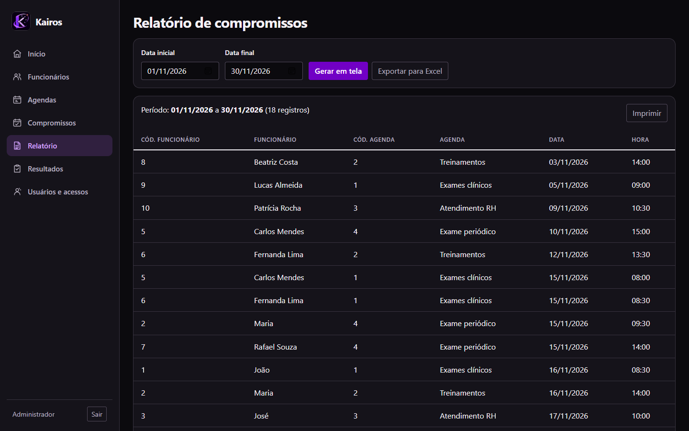
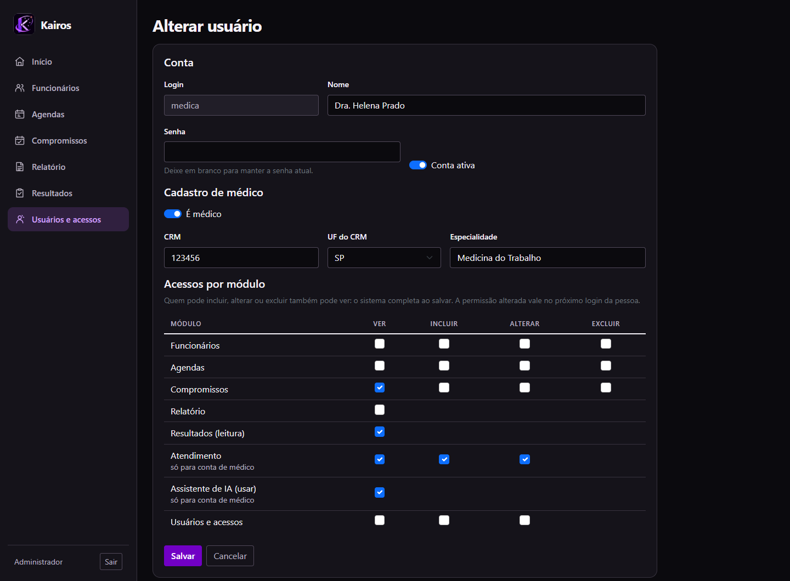
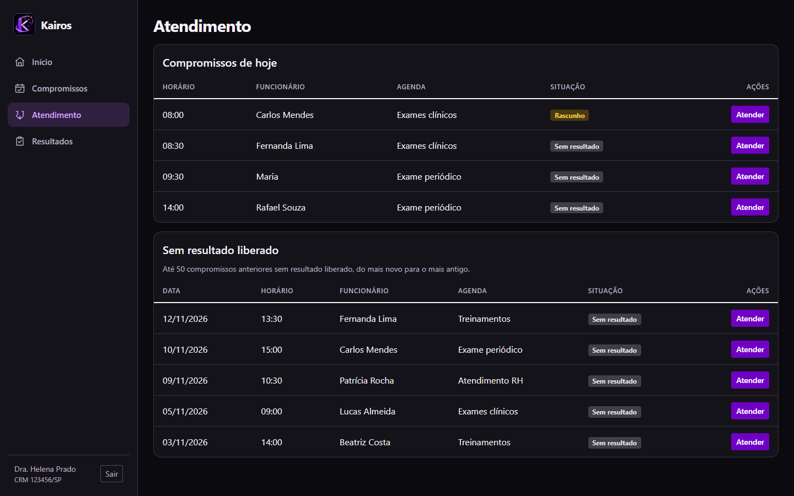
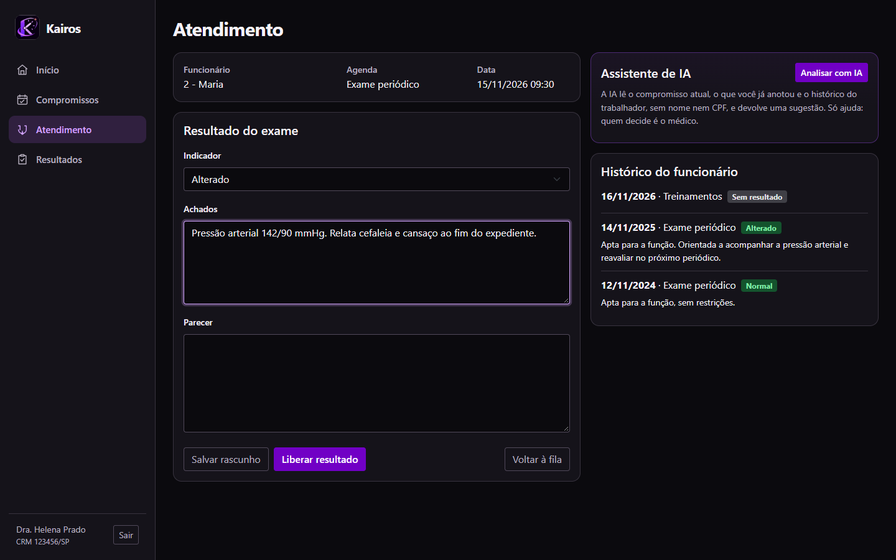
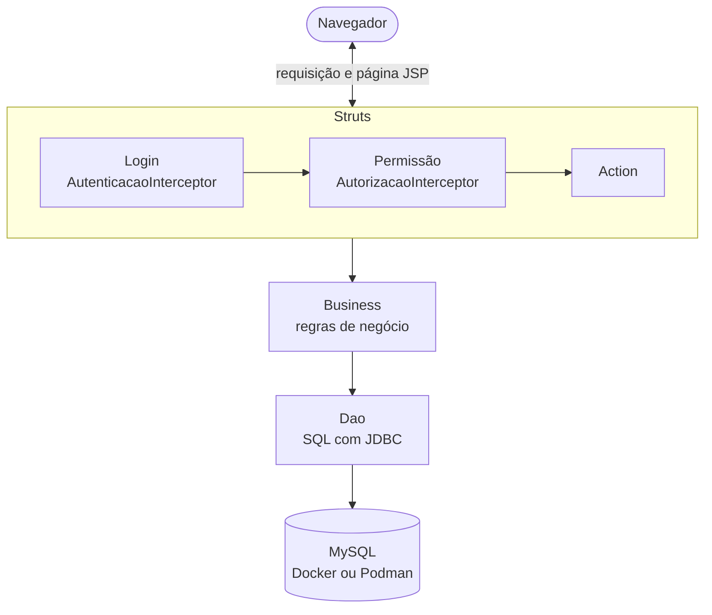
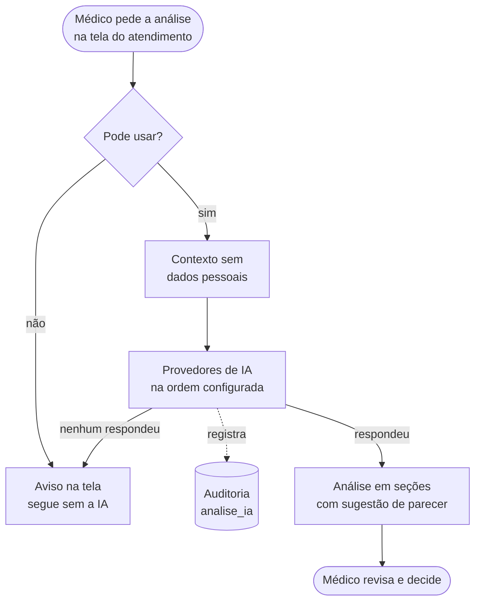

# Kairos

Sistema de gestão de funcionários, agendas e compromissos, com relatório por período em tela e em Excel.

Desenvolvido para um desafio técnico, a partir do zero, com a arquitetura em camadas e as tecnologias do projeto base: Java 8, Struts 2, JSP, Bootstrap, Jetty e Maven.

## Funcionalidades

### Atividades do desafio

| # | Atividade | Onde está |
| --- | --- | --- |
| 1 | Cadastro de funcionários | Menu Funcionários |
| 2 | Cadastro de agendas, com período disponível em `<select>` (Manhã, Tarde, Ambos) | Menu Agendas |
| 3 | Cadastro de compromissos | Menu Compromissos, em tabela e em calendário mensal |
| 4 | Excluir um funcionário exclui os compromissos dele | `FuncionarioBusiness.excluir` |
| 5 | Agenda com compromissos não pode ser excluída | `AgendaBusiness.excluir` |
| 6 | Compromisso fora do período da agenda é recusado | `CompromissoBusiness.validarHorario` |
| 7 | Relatório de compromissos por período, em HTML e em Excel | Menu Relatório |

### Além do desafio

| Funcionalidade | Descrição |
| --- | --- |
| Login | Acesso por usuário e senha, com a senha guardada como hash PBKDF2. |
| Usuários e acessos | Permissões por módulo (ver, incluir, alterar, excluir), conferidas no servidor, e cadastro de médico com CRM e UF. |
| Atendimento médico | Fila do dia, resultado do exame em rascunho, liberação assinada pelo médico e retificação com histórico de versões. |
| Resultados | Consulta dos resultados liberados. |
| Assistente de IA | Apoio ao parecer do médico: analisa o atendimento e o histórico, sem dados que identifiquem o funcionário, e sugere um texto que o médico pode editar. |

Cada regra de negócio tem um código (`RN-CO-04`, `RN-AT-03`...) descrito em [docs/requisitos.md](docs/requisitos.md) e citado no código onde é aplicada.

## Telas

| | |
| --- | --- |
|  |  |
| **Login** | **Compromissos**, em tabela e em calendário mensal |
|  |  |
| **Relatório** por período, em tela e em Excel | **Usuários e acessos**, com permissões por módulo |
|  |  |
| **Fila do médico** com os compromissos do dia | **Atendimento**, com histórico e assistente de IA |

## Como executar

Pré-requisitos: **JDK 8** e **Docker** ou **Podman**. O Maven vem com o projeto (wrapper).

O script sobe o banco no Docker ou no Podman, o que estiver disponível, espera ele ficar pronto e inicia a aplicação:

```bat
:: Windows
set JAVA_HOME=C:\caminho\do\jdk8
subir.cmd
```

```bash
# Linux e macOS
JAVA_HOME=/caminho/do/jdk8 ./subir.sh
```

Acesse http://localhost:8080/kairos.

| Usuário | Senha | Perfil |
| --- | --- | --- |
| `admin` | `kairos` | Administração: cadastros, relatório, resultados, usuários e acessos |
| `medica` | `kairos` | Médica: atendimento, resultados e assistente de IA |

Para encerrar, use `Ctrl+C` na aplicação e `parar.cmd` (ou `./parar.sh`) para o banco.

| Para | Windows | Linux e macOS |
| --- | --- | --- |
| Subir só o banco | `subir.cmd banco` | `./subir.sh banco` |
| Usar o Podman com o Docker também ativo | `set MOTOR=podman` | `MOTOR=podman ./subir.sh` |
| Usar outra porta na aplicação | `set PORTA=8082` | `PORTA=8082 ./subir.sh` |
| Apagar os dados e recriar o banco | `parar.cmd apagar` | `./parar.sh apagar` |

Sem o script: `docker compose up -d` (ou `podman compose up -d`) e `./mvnw jetty:run` (Windows: `mvnw.cmd jetty:run`).

**Observações**

- A primeira execução baixa a imagem do MySQL e as dependências do Maven, e o banco leva alguns minutos para ser criado.
- O Podman precisa de um compose instalado. No Podman Desktop: Settings, Resources, Compose.
- Se a porta 3306 estiver ocupada, outro MySQL está em execução. A porta do banco pode ser trocada com `DB_PORT` no arquivo `.env`.
- Banco, usuário e senha do MySQL têm valores padrão de desenvolvimento. Para alterá-los, copie `.env.example` para `.env`.
- O assistente de IA vem desligado. Para ativá-lo, informe o provedor e a chave no `.env`, conforme o `.env.example`. O provedor `falso` exibe uma resposta de demonstração, sem chave.

## Testes

```bash
./mvnw test
```

Testes de unidade das regras de negócio, executados sem banco. A relação entre cada regra e seu teste está em [docs/requisitos.md](docs/requisitos.md#testes-automatizados).

## Tecnologias

| Camada | Tecnologia |
| --- | --- |
| Linguagem | Java 8 |
| Web | Struts 2.5.28.3 e JSP |
| Interface | Bootstrap 5.1.3 |
| Banco de dados | MySQL 8.4 em container, acesso por JDBC |
| Servidor | Jetty 9.4.7 |
| Planilha | Apache POI 5.2.5 |
| Testes | JUnit 4 |
| Build | Maven |

## Arquitetura

### Fluxo principal

Toda requisição segue o mesmo caminho: passa pelos interceptores de login e de permissão, chega à Action e desce pelas camadas até o banco.



### Assistente de IA

Recurso adicional da tela do atendimento. O pedido percorre o mesmo caminho do fluxo principal, e a resposta volta em JSON para o painel da tela.



- **Pode usar:** a conta é de médico, a IA está configurada e o limite diário de análises não foi atingido.
- **Contexto:** o atendimento atual e o histórico do funcionário, sem nome, CPF ou e-mail.
- **Provedores:** Claude, OpenAI, Gemini ou DeepSeek, na ordem definida no `.env`. Se um falhar, o próximo é tentado.
- **Auditoria:** toda análise fica registrada, com o pedido enviado e a resposta ou o erro.
- **Decisão:** a sugestão só entra no parecer quando o médico escolhe usá-la, e continua editável.

### Organização do código

```
src/main/java/br/com/kairos/
  action/      recebe os dados da tela e escolhe a próxima página
  business/    regras de negócio
  dao/         acesso ao banco com JDBC
  vo/          objetos de dados
  infra/       conexão, transação, interceptores de login e de permissão, planilha, calendário
  infra/ia/    integração com os provedores de IA
  exception/   exceções de negócio e técnicas
src/main/resources/   configuração do Struts e textos das telas
src/main/webapp/      páginas JSP, CSS e JavaScript
db/                   criação das tabelas e dados de exemplo
docs/                 requisitos e processo de desenvolvimento
```

## Decisões técnicas

- **MySQL em container no lugar do H2 em memória.** Os dados persistem entre execuções e as regras são validadas contra um banco real, com chaves estrangeiras.
- **Fronteira entre manhã e tarde.** Manhã vai de 00:00 a 11:59 e tarde de 12:00 a 23:59, definido em um único lugar, o enum `Periodo`.
- **Mudança de período da agenda.** O período só muda se os compromissos existentes continuarem dentro dele. Sem isso, a atividade 6 poderia ser contornada alterando a agenda depois de criar o compromisso.
- **Regras na camada de negócio.** A exclusão em cadeia roda em transação na classe Business, e não por `ON DELETE CASCADE`. A regra fica visível no código e as chaves estrangeiras continuam como última barreira.
- **Erros técnicos tratados.** Falhas de banco viram `TechnicalException`, são registradas em log e o usuário vê uma página de aviso.
- **Segurança.** Consultas com `PreparedStatement`, saída escapada nos JSPs, gravação só por POST vindo do próprio sistema, senha com PBKDF2 e troca do identificador de sessão no login.
- **Permissões por interceptor.** Cada Action declara seu módulo no `struts.xml` e um interceptor confere a permissão antes de executá-la. O menu oculta o que o usuário não pode acessar, mas o bloqueio é feito no servidor.
- **Resultado separado do compromisso.** O resultado do exame fica em tabela própria, com as versões anteriores preservadas a cada retificação.
- **IA sem dependência de SDK.** Os provedores (Claude, OpenAI, Gemini e DeepSeek) são chamados por HTTP com recursos do próprio Java 8, atrás de uma interface única. Trocar de provedor é configuração, e a chave fica fora do código.

## Documentação

- [docs/requisitos.md](docs/requisitos.md): regras de negócio, origem de cada uma e testes que as cobrem.
- [AGENTS.md](AGENTS.md): instruções para assistentes de programação com IA, válidas para qualquer ferramenta.
- [docs/desenvolvimento-com-ia.md](docs/desenvolvimento-com-ia.md): como as instruções para IA estão organizadas e como mantê-las.
